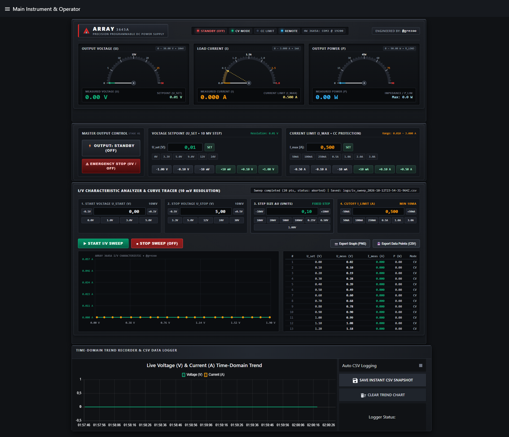

# ARRAY® 364X / 3645A Programmable DC Power Supply — Precision Lab Instrument Controller & I/V Curve Tracer

**Engineered by [@grezoo](https://github.com/grezoo)**

Industrial carbon-grey Node-RED instrument controller, real-time telemetry monitor, automated **I/V Characteristic Curve Tracer**, and time-domain CSV data logger for **Array Electronic 364X / 3600 Series** (e.g., **Array 3644A / 3645A / 3646A**) programmable DC laboratory power supplies.



---

## Key Features

### 1. Carbon-Grey Modular Lab Instrument Interface
- **Instrument Meters & Telemetry Panel:**
  - **ARRAY® Electronic** industrial nameplate, real-time serial link & operating mode status indicators (`OUTPUT ON/STANDBY`, `CV MODE`, `CC LIMIT`, `REMOTE`, `COM3 @ 19200 BAUD`), and **@grezoo** engineering badge.
  - **3 Precision Analog + Digital Instrument Meters (`U`, `I`, `P`):**
    - **Output Voltage (`0.00 – 30.00 V`):** `10 mV` (`0.01 V`) resolution with dual pointers (dashed setpoint `U_set` + solid measured `U_meas`) and digital readout.
    - **Load Current (`0.000 – 3.000 A`):** `1 mA` (`0.001 A`) resolution with dual pointers (current limit `I_max` $\ge 10\text{ mA}$ + measured current `I_meas`).
    - **Output Power (`0.00 – 90.00 W`):** Real-time output power and calculated load impedance (`Ω`).
- **Output & Setpoint Control Stage:**
  - **MASTER OUTPUT (`OUTPUT ACTIVE / STANDBY`)** switch and instant **EMERGENCY STOP (`0V / OFF`)** cutoff button.
  - Direct numeric entry, quick voltage presets (`0V`, `3.3V`, `5.0V`, `9.0V`, `12V`, `24V`), and precision step buttons (`±1.00 V`, `±0.10 V`, `±10 mV [0.01 V]`).
  - Current limit (`I_max`) control from `0.010 A` (`10 mA`) to `3.000 A` (protected against zero current limit).
- **I/V Characteristic Analyzer & Curve Tracer:**
  - Automated voltage sweep ($U_{\text{start}} \rightarrow U_{\text{stop}}$) with selectable step resolutions (**`10 mV`**, **`20 mV`**, **`50 mV`**, **`100 mV`**, **`0.25 V`**, **`0.50 V`**, **`1.00 V`**) and automatic current cutoff ($I_{\text{limit}} \ge 10\text{ mA}$).
  - Automatic hardware range/tap transition re-latching across the `4.00 V` boundary for glitch-free linear ramps even under no-load conditions.
  - Live X-Y characteristic oscilloscope plot and scrollable measurement table.
  - One-click **PNG Graph Export** and **CSV Data Point Export**.
- **Time-Domain Trend Recorder & CSV Data Logger:**
  - Continuous rolling voltage/current time-domain trend chart and automatic or snapshot-based CSV logging into the `logs/` directory.

### 2. Native 26-Byte Array Binary Protocol & RS232 + Virtual Simulator
- Full manufacturer **26-byte binary protocol** (`0xAA` start byte, Little-Endian scaling, modulo-256 checksum):
  - `0x80`: Set voltage (`10 mV` resolution), current limit (`1 mA`), OVP, and OPP parameters.
  - `0x81`: Cyclic real-time telemetry readback (`U`, `I`, `P`, `CV/CC/OPP/Remote` status bits).
  - `0x82`: PC remote control (`Remote`) and output relay (`Output ON/OFF`) control.
  - `0x8C` / `0x12`: Model/firmware query and ACK (`0x80`) / NAK (`0x90`) verification.
- Automatic **DTR + RTS line power** for the Array 3311/3312 optical RS232 interface adapter.
- Built-in **Virtual Power Supply Simulator (Mock mode)** with adjustable load resistance (`1–100 Ω`) for offline testing.

---

## Quick Start & Testing

- **Launch Application (One-Click Windows Launcher):**
  ```bat
  start_array_power.bat
  ```
  Automatically starts the Node-RED runtime and opens the instrument dashboard at **[http://localhost:1880/ui](http://localhost:1880/ui)**.

- **Run Unit & E2E Test Suite (105 Tests):**
  ```powershell
  npm test
  ```

---

**Author / System Engineer:** [@grezoo](https://github.com/grezoo)
